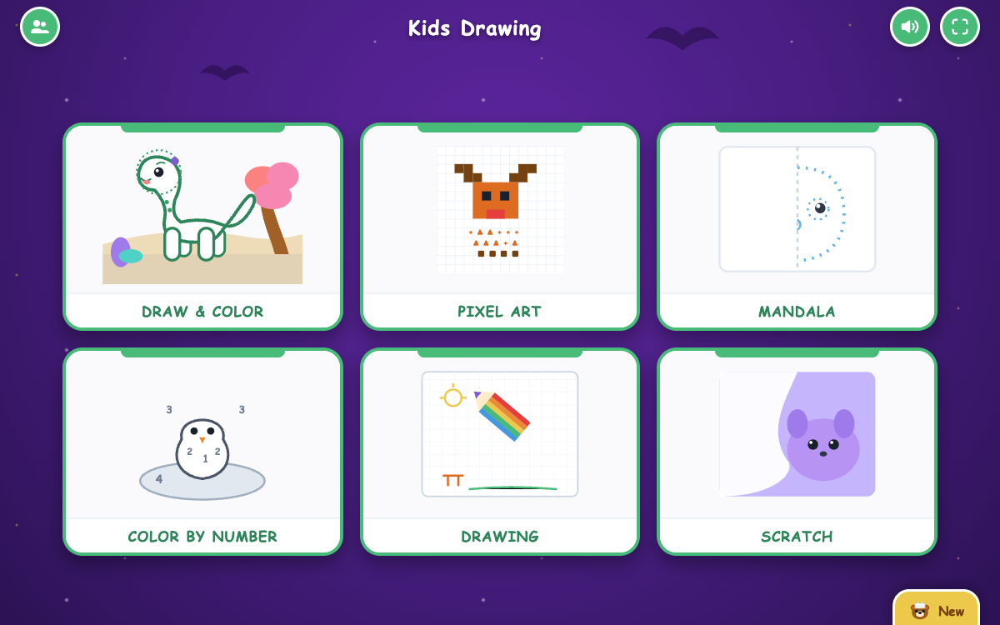

# Kids Drawing & Coloring Game

Interactive recreation of the popular children's educational drawing app (**Kids Color Games: Baby Drawing** by Bimi Boo Kids) featuring 6 interactive game modes with authentic templates and creative tools.



---

## 🌟 6 Interactive Game Modes

1. **Draw & Color (Tap-to-Fill with Pure White Base & Clean Outlines)**:
   - **8 Templates**:
     - `Dinosaurus`: Cute long-necked sauropod with head dots, flower hairpin, tree, rocks, and soft ground.
     - `Kucing Lucu`: Playful kitten with yarn ball and carpet.
     - `Mobil Balap`: Race car with #7 badge and racetrack clouds.
     - `Roket Angkasa`: Space rocket with cratered moon and Saturn-like ring planet.
     - `Gajah Cilik`: Baby elephant spraying water droplets from trunk.
     - `Kupu-Kupu`: Patterned butterfly in flower garden.
     - `Kapal Layar`: Sailboat on waves with bright sun and buoy.
     - `Kue Ulang Tahun`: Multi-tier birthday cake with candles and balloons.
   - **Characteristics**: All canvases start 100% pure white (`#ffffff`) with clean outlines.
   - **Features**: Tap-to-fill, reset, confetti celebration, and PNG export.

2. **Pixel Art**:
   - **4 Templates**: Reindeer (14x14 grid matching tablet photo), Pixel Car, Pixel Cat, and Blank Grid.
   - **Features**: Geometric guide symbols, automated sample solution, reset, and PNG export.

3. **Mandala & Mirror Art**:
   - **4 Symmetry Modes**: 2-Way Vertical Mirror (Owl), Butterfly Wing Mirror, 4-Way Radial Blossom, and 8-Way Kaleidoscope Snowflake.
   - **Tools**: Marker brush, Dynamic Rainbow pencil, Glow/Neon pen, and PNG export. Automatic switch from rainbow to pen upon palette color selection.

4. **Color by Number**:
   - **4 Templates**: Penguin on ice floe, Astronaut in space, Ocean sailing ship, and Rainbow pony.
   - **Features**: Number segments 1 to 6 with active glow feedback and celebration upon completion.

5. **Drawing Notepad (Free Draw)**:
   - **4 Paper Backgrounds**: Grid paper (milimeter block), Lined notebook, Blackboard, and Plain white paper.
   - **Tools**: Brush (Kuas), Rainbow pencil, Glow pen, Spray can, Star pattern roller, Vector stamp, Eraser, and PNG export. Palette swatch click automatically switches back to Kuas with selected color.

6. **Scratch Art**:
   - **4 Mystery Artworks**: Purple Raccoon, Savanna Lion, Clownfish, and Rainbow Castle.
   - **Features**: Realistic scratch SFX, live percentage indicator, and victory celebration confetti triggered strictly when image is revealed >80%.

---

## 🚀 Getting Started

### Local Development
```bash
# Clone the repository
git clone https://github.com/denismile22/kids-drawing-app.git
cd kids-drawing-app

# Start local server
./run.sh
# or
python3 -m http.server 3000
```
Open your browser at **http://localhost:3000**.

### Running Automated Test Suite
```bash
node run-tests.mjs
```
Runs headless Chrome CDP tests verifying 0 bugs, white base fills, zero emojis in UI, and scratch percentage threshold.

---

## 🛠️ Technical Details
- **Zero External Dependencies**: Pure HTML5, Canvas API, SVG, and Vanilla JavaScript.
- **Web Audio API**: Procedurally synthesized sound effects (Pop, Pling melody notes, Scratch noise, Fanfare) without external audio files.
- **Touch & Tablet Optimized**: Full support for pointer events (mouse, finger touch, and stylus pen).
